# Investigaciones Geográficas Interactivas para la Mejora
| Proyecto | Vista Previa | Descripción | Enlace |
|----------|-------------|-------------|--------|
| **[Indicadores de Trata Infantil](http://sigeh.hidalgo.gob.mx/pags/Tablero_Turismo/)** |  | Mapa interactivo que muestra tipos de delitos, sitios turísticos y empresas del sector. Incluye gráficos sobre la población de 5 a 17 años en ocupaciones no permitidas. | [🔗 Ver más](http://sigeh.hidalgo.gob.mx/pags/Tablero_Turismo/) |
| **[Análisis de Tomas Clandestinas de Agua](http://sigeh.hidalgo.gob.mx/pags/tomas_clandestinas/)** |  | Mapa interactivo que muestra tanto los usuarios con tomas de agua como las tomas clandestinas. | [🔗 Ver más](http://sigeh.hidalgo.gob.mx/pags/tomas_clandestinas/) |
| **[Índice de Prioridad Alimentaria](http://sigeh.hidalgo.gob.mx/pags/alimentario/)** |  | Mapa interactivo con comedores y su índice de prioridad alimentaria. | [🔗 Ver más](http://sigeh.hidalgo.gob.mx/pags/alimentario/) |
| **[Aptitud Rellenos Sanitarios](http://sigeh.hidalgo.gob.mx/pags/rellenos/)** |  | Mapa sobre la capacidad de rellenos sanitarios con una paleta de colores. | [🔗 Ver más](http://sigeh.hidalgo.gob.mx/pags/rellenos/) |
| **[Emisión de Gases de Efecto Invernadero](http://sigeh.hidalgo.gob.mx/pags/semarnath/)** |  | Mapa interactivo que muestra la emisión de metano por la crianza de bovinos o porcinos, las emisiones en SDF y las acciones de mitigación. | [🔗 Ver más](http://sigeh.hidalgo.gob.mx/pags/semarnath/) |
| **[Incidentes con Fauna Feral](https://jairesc.github.io/Aprendizaje//Leaflet/mapa_mordedura_perros.html)** |  | Mapa interactivo que resume incidentes con perros y gatos salvajes. | [🔗 Ver más](https://jairesc.github.io/Aprendizaje//Leaflet/mapa_mordedura_perros.html) |
| **[Movilidad](http://sigeh.hidalgo.gob.mx/pags/movilidad/)** | 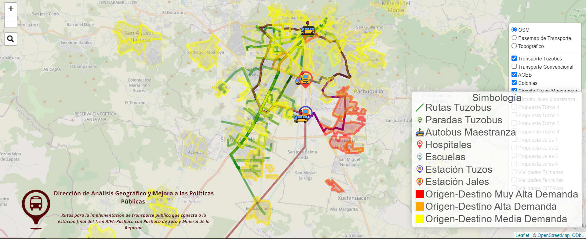 | Mapa interactivo sobre las rutas de transporte público conectando la estación final del Tren AIFA-Pachuca con Pachuca de Soto y Mineral de la Reforma. | [🔗 Ver más](http://sigeh.hidalgo.gob.mx/pags/movilidad/) |
| **[Oportunidades/Problemáticas Hidalgo](http://sigeh.hidalgo.gob.mx/pags/OportunidadesHidalgo/)** |  | Mapa con las principales problemáticas de cada municipio, categorizadas por sector. | [🔗 Ver más](http://sigeh.hidalgo.gob.mx/pags/OportunidadesHidalgo/) |
| **[Tablero Indicadores Turismo](http://sigeh.hidalgo.gob.mx/pags/IndicadoresTurismo/)** |  | Mapa con sitios turísticos y gráficos sobre turistas y PIB turístico. | [🔗 Ver más](http://sigeh.hidalgo.gob.mx/pags/IndicadoresTurismo/) |
| **[Complejidad Económica 2024](http://sigeh.hidalgo.gob.mx/pags/complejidad/)** |  | Sitio que explica el cálculo del índice de complejidad económica y su código en R. | [🔗 Ver más](http://sigeh.hidalgo.gob.mx/pags/complejidad/) |
| **[Gasoducto](http://sigeh.hidalgo.gob.mx/pags/gasoducto/)** | 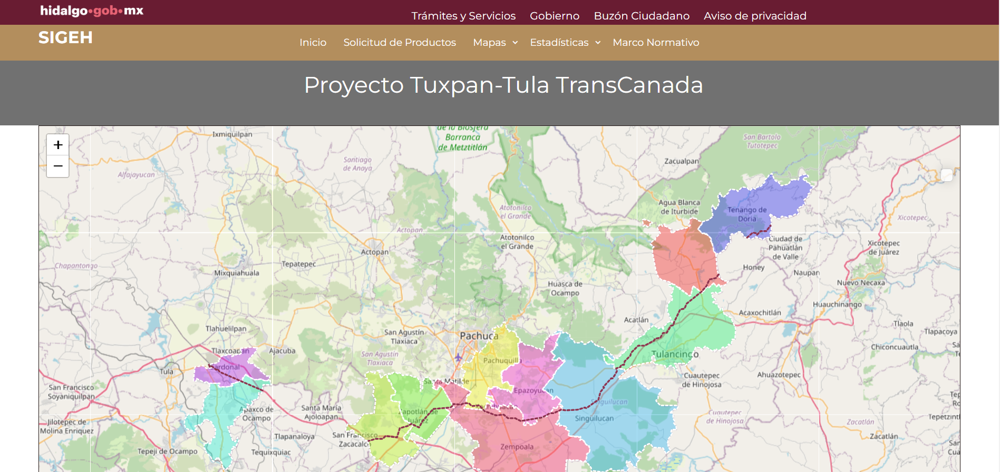 | Mapa del proyecto Tuxpan-Tula TransCanada. | [🔗 Ver más](http://sigeh.hidalgo.gob.mx/pags/gasoducto/) |
| **[Tablero de Indicadores Nacional e Histórico](https://labpoliticas.hidalgo.gob.mx/tablero)** |  | Sitio interactivo con indicadores sobre medio ambiente, economía, gobierno y sociedad. **[Link GITHUB](https://jairesc.github.io/Tablero_Indicadores/)**| [🔗 Ver más](https://labpoliticas.hidalgo.gob.mx/tablero) |
| **[Tablero de Incidentes Delictivos](http://sigeh.hidalgo.gob.mx/pags/seguridad/)** | 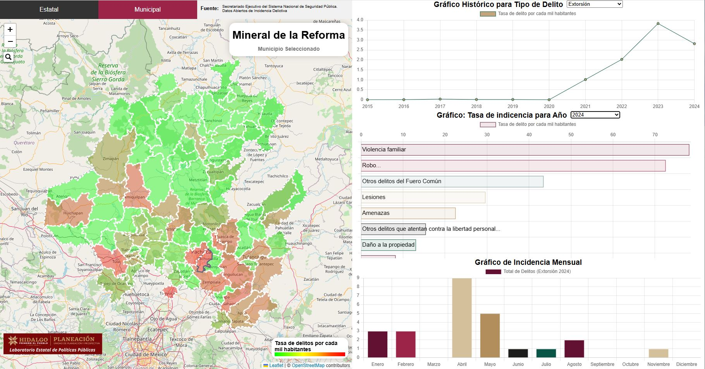 | Sitio interactivo con datos según tipo de delito en el estado de Hidalgo. Información actualizada a Marzo 2025 | [🔗 Ver más](http://sigeh.hidalgo.gob.mx/pags/seguridad/) |
| **[Tablero de Complejidad Económica](https://sigeh.hidalgo.gob.mx/ice/)** | 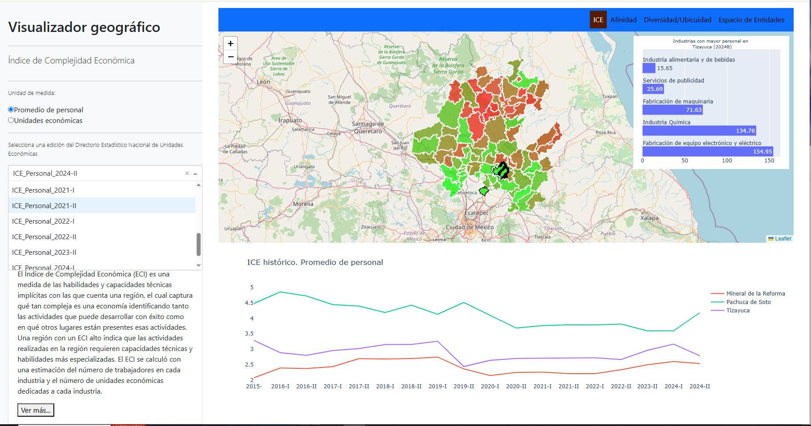 | Sitio interactivo con indicadores de complejidad económica para Hidalgo.  **Link externo.** **[Link POSIT](https://sigehgo-complejidad-economica.share.connect.posit.cloud/)** | [🔗 Ver más](https://sigeh.hidalgo.gob.mx/ice/) |
| **[Actividades Económicas](https://sigeh.hidalgo.gob.mx/pags/actividades_economicas/)** | 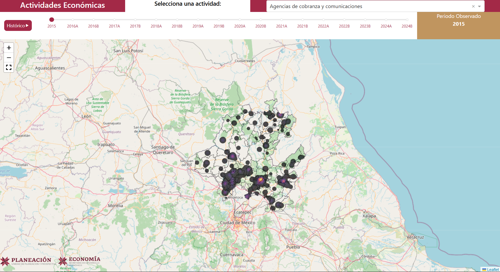 | Mapa web interactivo, que muestra un kernel de densidad de la actividad económica elegida para un período específico. |[🔗 Ver más](https://sigeh.hidalgo.gob.mx/pags/actividades_economicas/) |
| **[Indicadores de Calidad del Agua](https://sigeh.hidalgo.gob.mx/ceaa/)** | 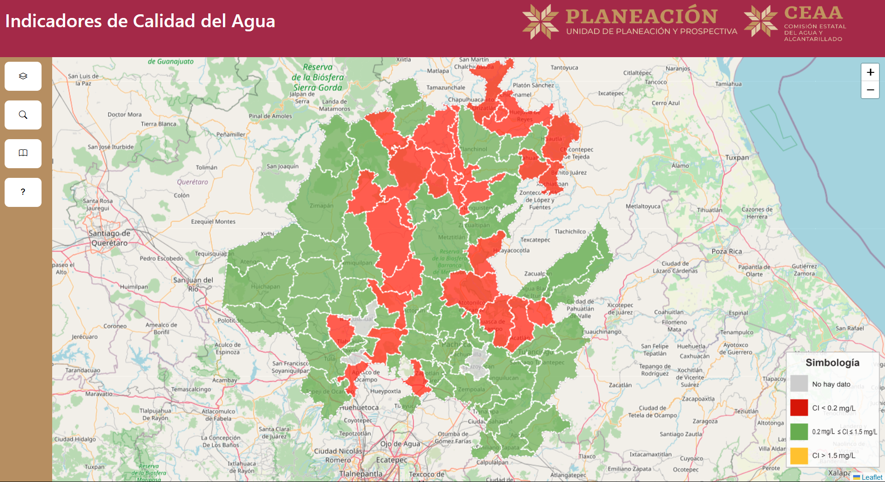 | Mapa web interactivo que muestra los niveles de cloro residual libre por municipio y por región, según el año seleccionado. | [🔗 Ver más](https://sigeh.hidalgo.gob.mx/ceaa/) |
| **[Accidentes vehiculares](http://sigeh.hidalgo.gob.mx/pags/accidentes_vehiculares/)** | 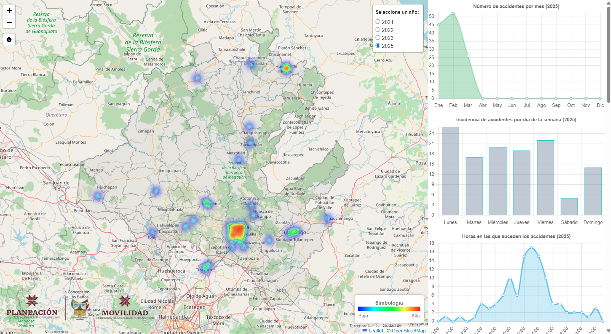 |Mapa web interactivo que muestra los accidentes en el estado de Hidalgo según el año elegido, junto con gráficas que se actualizan según la información mostrada. | [🔗 Ver más](http://sigeh.hidalgo.gob.mx/pags/accidentes_vehiculares/) |
| **[Indice de Competitividad](https://github.com/SIGEHgo/Investigaciones-geograficas-interactivas-para-la-mejora/blob/aaf666df967eb68aff73c31783df38ef09e3708e/Imagenes/IMCO%20Indicadores.xlsx)** | 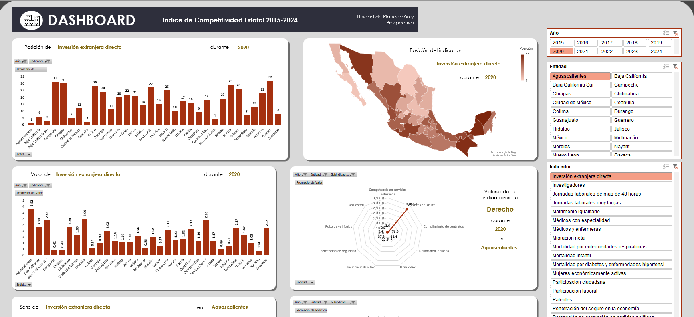 | DasBoard sobre el Indice de Competitividad Estatal 2015-2024  | [🔗 Ver más](https://github.com/SIGEHgo/Investigaciones-geograficas-interactivas-para-la-mejora/blob/aaf666df967eb68aff73c31783df38ef09e3708e/Imagenes/IMCO%20Indicadores.xlsx) |
| **[Analisis de Incidentes](http://sigeh.hidalgo.gob.mx/post/seguridad1/)** | 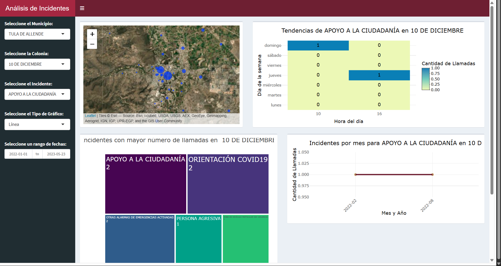 |  Sitio web interactivo que muestra los incidentes reportados al 911, incluyendo gráficas según la zona seleccionada. | [🔗 Ver más](http://sigeh.hidalgo.gob.mx/post/seguridad1/) |
| **[Banco Unico de Información Estadistica](https://labpoliticas.hidalgo.gob.mx/buie)** | 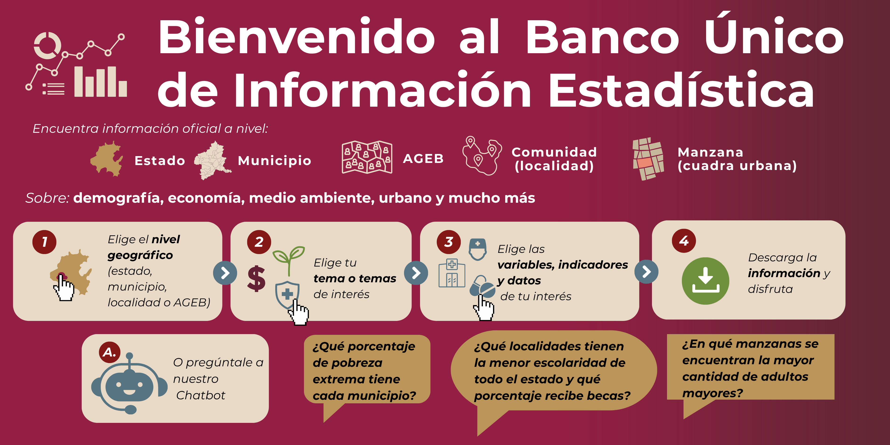 | Sitio web que te permite Chatear, Acceder, Filtrar, Visualizar y Obtener información oficial sobre diversos sectores del estado de Hidalgo y también a nivel Nacional| [🔗 Ver más](https://labpoliticas.hidalgo.gob.mx/buie) |
| **[Indicadores de Desempeño Municipal](https://sigeh.hidalgo.gob.mx/indemun/)** | 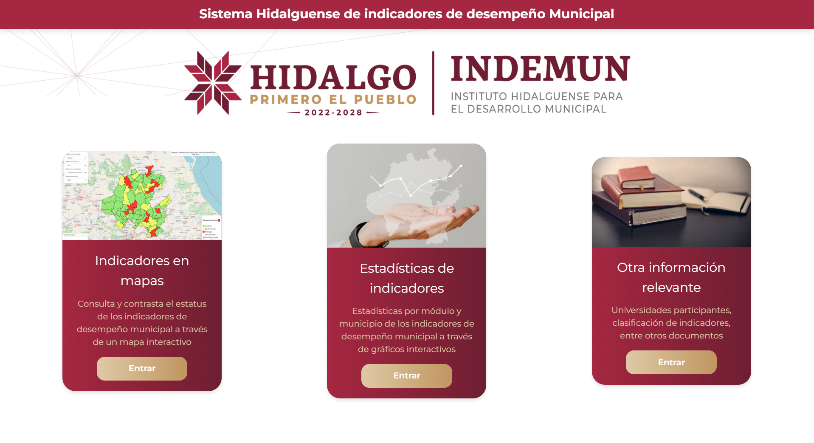 | Sitio web sobre el Sistema Hidalguense de Indicadores de Desempeño Municipal(INDEMUN) el cual tiene los indicadores en mapas, Estadisticas de indicadores y Otra información relevante | [🔗 Ver más](https://sigeh.hidalgo.gob.mx/indemun/) |
| **[Pobreza por Localidad](http://sigeh.hidalgo.gob.mx/pags/pobreza_localidad/)** | 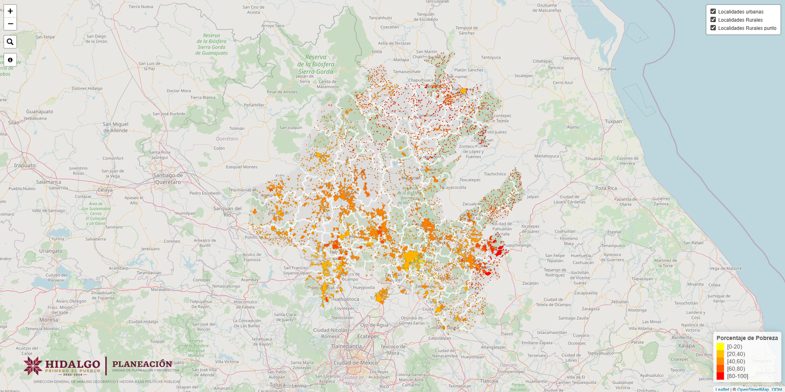 |Mapa web interactivo que muestra el porcentaje de pobreza a nivel localidad.  | [🔗 Ver más](http://sigeh.hidalgo.gob.mx/pags/pobreza_localidad/) |
| **[Progreso Censo de Gobierno](https://sigehgo.github.io/Progreso-Censos-de-Gobiernos/)** | 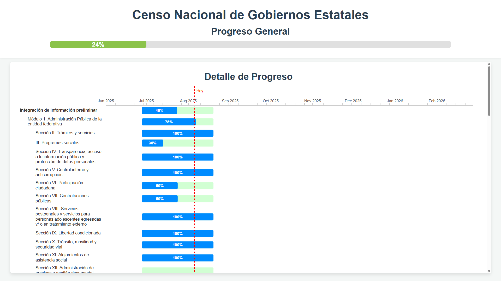 | Sitio web que te permite observar el avance del Censo de Gobierno en los diversos módulos y secciones. | [🔗 Ver más](https://sigehgo.github.io/Progreso-Censos-de-Gobiernos/) |
| **[Emergencias](https://sigehgo-emergencias.share.connect.posit.cloud)** | 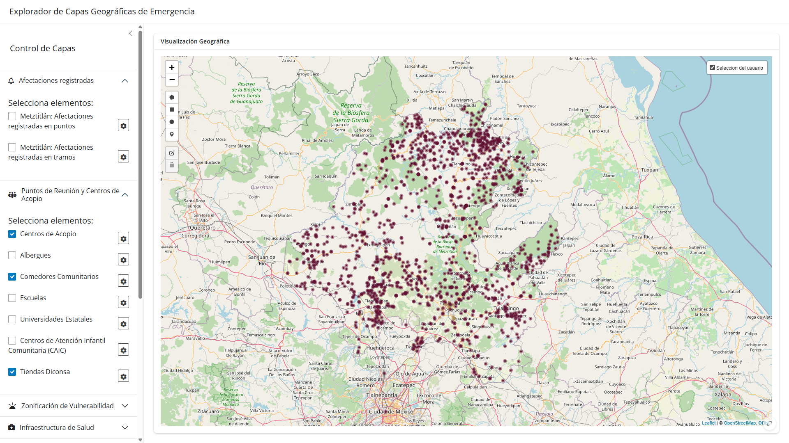 | Mapa web para la exploración de capas geográficas relacionadas con emergencias, que integra diversos temas como afectaciones registradas, puntos de reunión y centros de acopio, zonificación de vulnerabilidad, infraestructura de salud, recursos hídricos, entre otros. El mapa web permite seleccionar las capas de interés, ajustar sus parámetros y realizar figuras personalizadas para facilitar el análisis y la toma de decisiones en situaciones de emergencia. **[Link POSIT](https://sigehgo-emergencias.share.connect.posit.cloud)**| [🔗 Ver más](https://sigehgo-emergencias.share.connect.posit.cloud) |
| **[Vialidades de mayor tránsito en el estado de Hidalgo y su percepción](https://sigehgo.github.io/Nivel-de-uso-y-percepcion-de-vialidades/Mapa_web_Correlaciones.html)** | 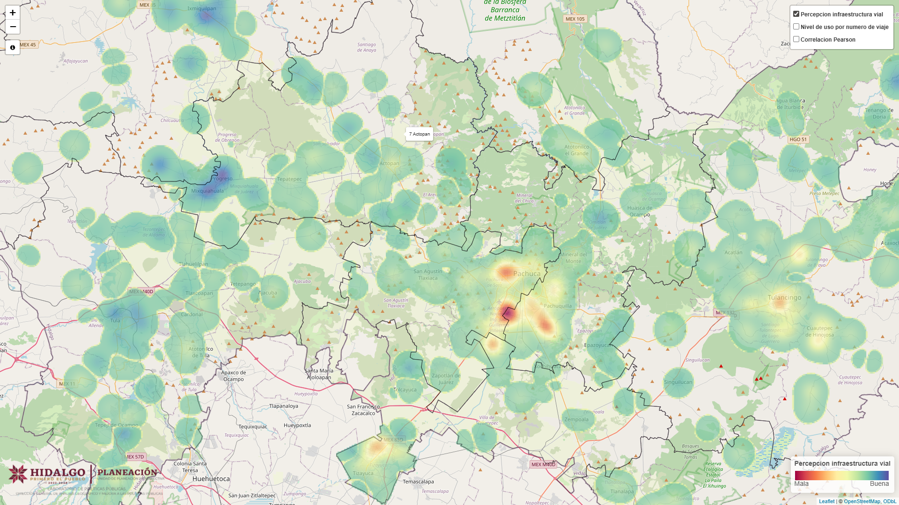 | Documento que a través de un análisis define cuáles son las vías más transitadas en el estado. **[Link GITHUB](https://sigehgo.github.io/Nivel-de-uso-y-percepcion-de-vialidades/Mapa_web_Correlaciones.html)** | [🔗 Ver más](https://sigehgo.github.io/Nivel-de-uso-y-percepcion-de-vialidades/Mapa_web_Correlaciones.html) |
| **[Estimación de la Aptitud para Desarrollo Urbano](https://jairesc.github.io/Aptitud-Urbana/)** | 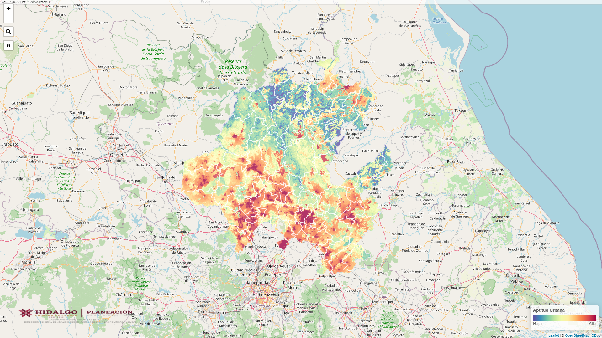 |Metodología que se auxilia de sistemas de información geográfica. **[Link GITHUB](https://jairesc.github.io/Aptitud-Urbana/)** | [🔗 Ver más](https://sigehgo-emergencias.share.connect.posit.cloud) |
| **[Programas, obras y acciones a nivel de municipios 2022-2025.](https://sigeh.hidalgo.gob.mx/pags/mun_inv3a_inv/)** | 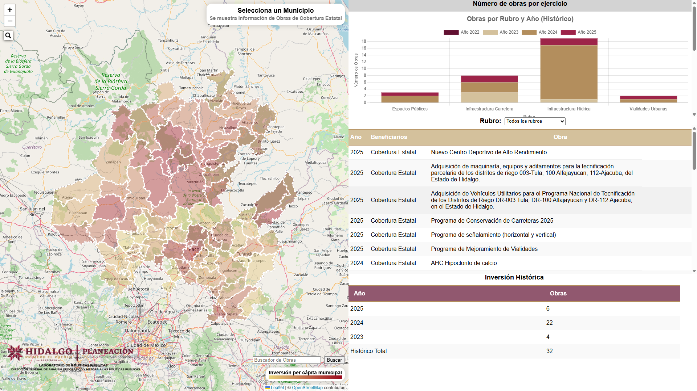 |Tablero de visualización geográfica de obras realizadas a nivel municipal con información de beneficiarios, año y tipo de obra. | [🔗 Ver más](https://sigeh.hidalgo.gob.mx/pags/mun_inv3a_inv/) |
| **[Habitos de Movilidad](https://sigehgo.github.io/Habitos_movilidad/)** | 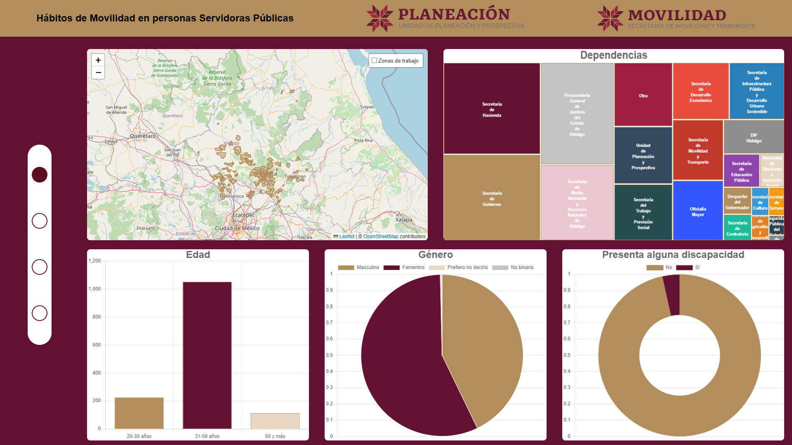 | Tablero web interactivo que se observa los habitos de movilidad de las personas Servidoras Publicas, el mapa web se encuentra a nivel codigo postal. **[Link GITHUB](https://sigehgo.github.io/Habitos_movilidad/)**| [🔗 Ver más](https://sigehgo.github.io/Habitos_movilidad/) |
| **[Estimación de la eficiencia y cumplimiento de las rutas de transporte de la Zona Metropolitana de Pachuca.](https://sigeh.hidalgo.gob.mx/coberturaTC/)** | 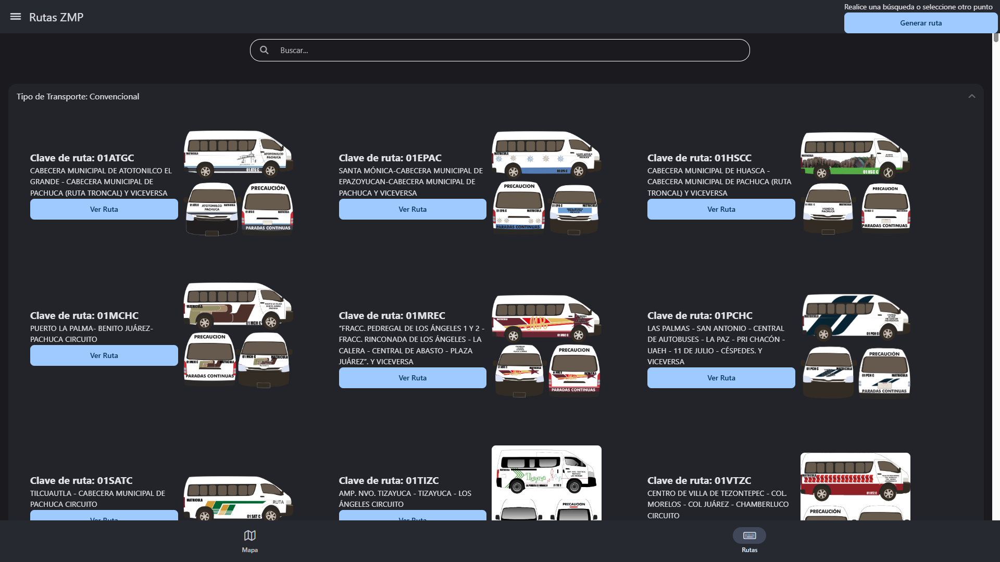 | Tablero dinámico de parámetros de cumplimiento de las principales rutas autorizadas en modalidad colectiva, para obtener una radiografía detallada y actualizada sobre la situación de su cumplimiento conforme a la dictaminación técnica.  **[Link POSIT](https://jaires.shinyapps.io/Rutas_ZMP/)** | [🔗 Ver más](https://sigeh.hidalgo.gob.mx/coberturaTC/) |
| **[Origenes-Destinos](https://sigeh.hidalgo.gob.mx/origen_destino/)** | 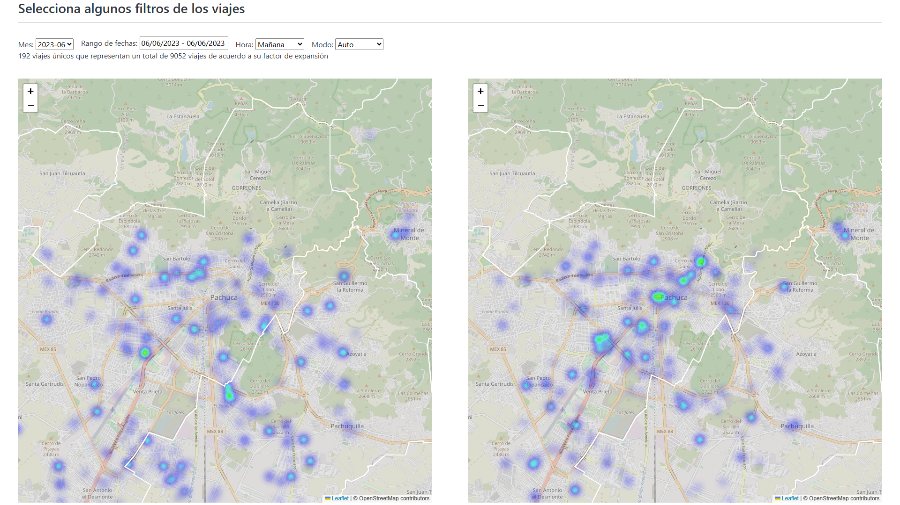 | Un mapa web interactivo donde el primer mapa muestra el lugar de origen del viaje con un factor de expansión sobre un mapa de calor, y el segundo mapa muestra los destinos desde donde comienzan esos viajes donde puedes filtrar apartir de mes, fecha, hora y modo de viaje. **[Link GITHUB](https://jairesc.github.io/Cityflow_origen_destinos/)**| [🔗 Ver más](https://sigeh.hidalgo.gob.mx/origen_destino/) |
| **[Monitoreo de indicadores microbiológicos y fisicoquímicos](https://sigehgo.github.io/Productos_Publicos/COPRISEH/)** | 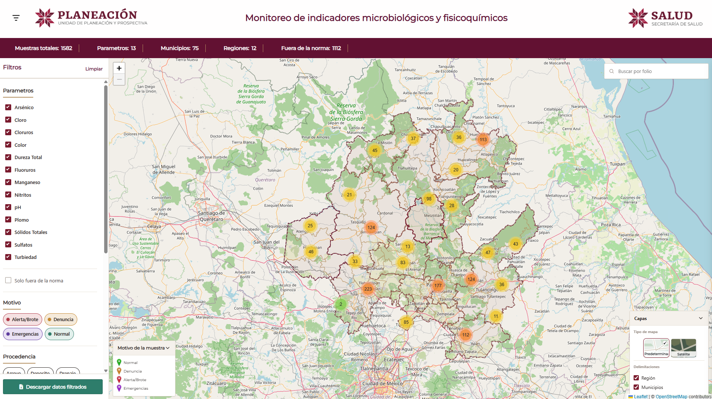 | Incorporación de bases de datos disponibles sobre parámetros microbiológicos y físico-químicos de distintos sitios muestreados por la COPRISEH, a fin de generar interpolación espacial para la visualización de puntos de interés, integrando capas temáticas tales como posibles fuentes de contaminación e infraestructura. | [🔗 Ver más](https://sigehgo.github.io/Productos_Publicos/COPRISEH/) |
| **[Visualizador de vilolencia contra las mujeres](https://sigehgo.github.io/Productos_Publicos/Centro_Justicia_Mujeres/Centro_Justicia_Mujeres_CEIEGH/index.html)** | 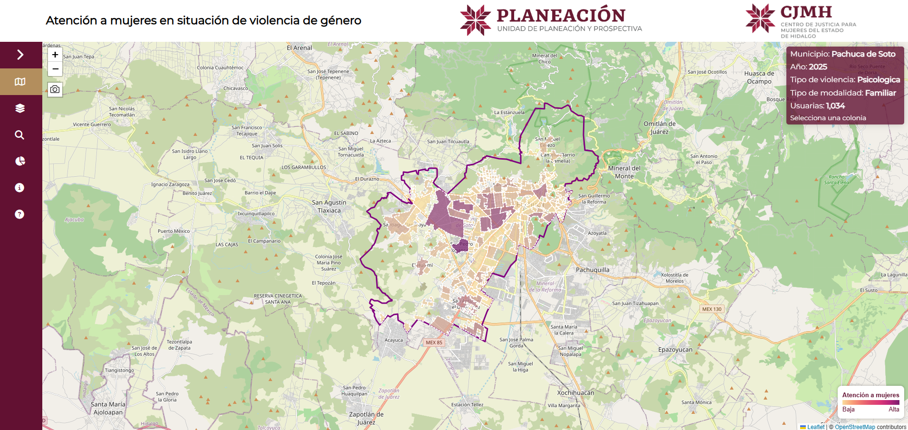 |Visualizador por tipo y modalidad de violencia contra las mujeres en las colonias de la Zona Metropolitana de Pachuca| [🔗 Ver más](https://sigehgo.github.io/Productos_Publicos/Centro_Justicia_Mujeres/Centro_Justicia_Mujeres_CEIEGH/index.html) |
| **[Estimación de la accesibilidad y cobertura de la infraestructura en salud a nivel estatal](https://jaires-riss-salud-ceiegh.share.connect.posit.cloud/)** | 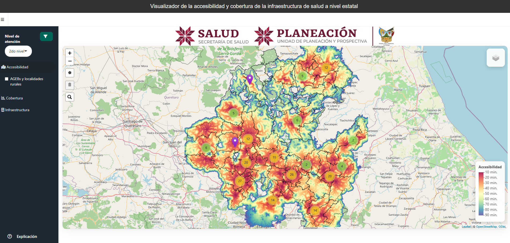 | Generación de información estadística georreferenciada sobre la accesibilidad de las localidades urbanas y rurales a la infraestructura de salud actual. Se integra en un mapa web que permita visualizar la distribución espacial de información poblacional y socioeconómica de relevancia para la toma de decisiones en materia de atención de la salud. 
 | [🔗 Ver más](https://jaires-riss-salud-ceiegh.share.connect.posit.cloud/) |
| **[Estimación de la cobertura de transporte público en localidades indígenas de Hidalgo](https://sigeh.hidalgo.gob.mx/pags/transporte_com_indig/)** | 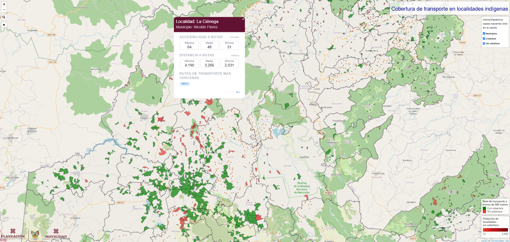 | Geoprocesamiento de rutas en formato vectorial. Se identifica como cobertura si una comunidad cuenta con una ruta de transporte público a menos de 500 metros.| [🔗 Ver más](https://sigeh.hidalgo.gob.mx/pags/transporte_com_indig/) |
| **[Sistema Estatal de Biodiversidad](https://sigeh.hidalgo.gob.mx/pags/sistema_estatal_biodiversidad/)** |  | Tablero interactivo para la visualización de flora, fauna y funga  en el estado de Hidalgo. Los avistamientos georreferenciados y con taxonomía de reino, orden, familia y especie se visualizan a través de un mapa, que permite filtrar y seleccionar avistamientos. Incluye capas de información geográfica de cobertura potencial, especies y en riesgo y otras capas de información. | [🔗 Ver más](https://sigeh.hidalgo.gob.mx/pags/sistema_estatal_biodiversidad/) |
| **[Plataforma para la mitigación de riesgos](https://sigeh.hidalgo.gob.mx/pags/capas_emergencias/)** |  | Tablero interactivo que recopila las principales fuentes de información geográficas de utilidad en la mitigación de riesgos, como albergues, escuelas, centros de salud, etc. | [🔗 Ver más](https://sigeh.hidalgo.gob.mx/pags/capas_emergencias/) |
| **[Atlas Estratégico de Riesgo Educativo](https://jaires.shinyapps.io/Atlas_riesgo_educativo_CEIEGH/)** |  | Integra información geoespacial, educativa y territorial de las escuelas, a fin de fortalecer la planeación estratégica, la gestión de riesgos y la priorización de intervenciones institucionales. | [🔗 Ver más](https://jaires.shinyapps.io/Atlas_riesgo_educativo_CEIEGH/) |
| **[Movilidad y Flujos de Tráfico en Escuelas](https://main.d4j409lmsveqx.amplifyapp.com/)** |  | Diseñar e implementar un sistema de análisis de movilidad en entornos escolares de educación básica, mediante herramientas geoespaciales para apoyar la toma de decisiones en materia de accesibilidad y planeación educativa. | [🔗 Ver más](https://main.d4j409lmsveqx.amplifyapp.com/) |